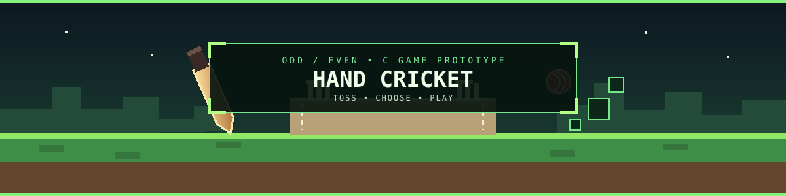

<div align="center">




# 🏏 Hand Cricket · Odd / Even Toss

**A small command-line C prototype inspired by hand cricket.**

[](https://en.cppreference.com/w/c)
[**Developer profile ↗**](https://github.com/dARSHANdR4)

</div>

<p align="center"></p>

## 🎮 Current project status

This repository currently contains a **toss prototype**. The C program chooses the computer's Odd/Even preference, asks the player for a toss number, generates a computer number, and prints the toss result / who is indicated to bat first.

**Important:** The checked-in source does not yet implement a complete innings, run tracking, wickets, or multi-over match. Those are good next features, but are not currently in the code.

> **Hosted demo:** This is a command-line C project; no browser-hosted version is published.

## 🧰 Requirements

- GCC or another C compiler
- Terminal / command prompt

## ⛏️ Build and run

Clone the repository:

```bash
git clone https://github.com/dARSHANdR4/Hand-Cricket-Toss-Odd-Even-Game.git
cd Hand-Cricket-Toss-Odd-Even-Game
```

Compile with GCC:

```bash
gcc odd_even_toss_game.c -o odd_even_toss_game
```

Run on macOS / Linux:

```bash
./odd_even_toss_game
```

Run on Windows:

```powershell
.\odd_even_toss_game.exe
```

## 🧭 How the current toss works

1. The computer randomly chooses Odd or Even as its preference.
2. Enter a number when prompted.
3. The program generates the computer's number and evaluates the sum's parity.
4. The terminal prints the toss outcome and a batting-first message.

This is an early prototype: validate inputs carefully and do not rely on it as a full match simulator.

## 🗺️ Next quests

- Replace non-standard `void main()` with standard `int main(void)`.
- Validate the player's toss input and explain the allowed range.
- Implement batting / bowling turns and run totals.
- Add wickets, target chasing, innings switching, and overs.
- Add sample terminal output and automated tests.

## 🤝 Contributing

Open an issue or pull request with a focused improvement.

<p align="center"></p>

<div align="center">

**Built by [dARSHANdR4](https://github.com/dARSHANdR4) · Voxel Builder / Developer / Automation**

</div>


## Copyright and permissions

Copyright © 2026 dARSHANdR4. All rights reserved.

Unless otherwise stated, original project code and assets are reserved and no open-source licence is granted. Third-party materials remain subject to their respective licences. Public repositories may still be viewed and forked through GitHub's platform functionality. See [COPYRIGHT](./COPYRIGHT) for the full notice.
